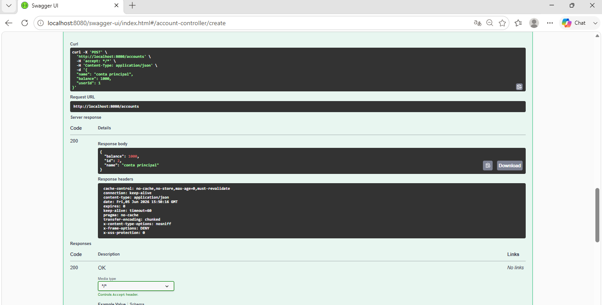
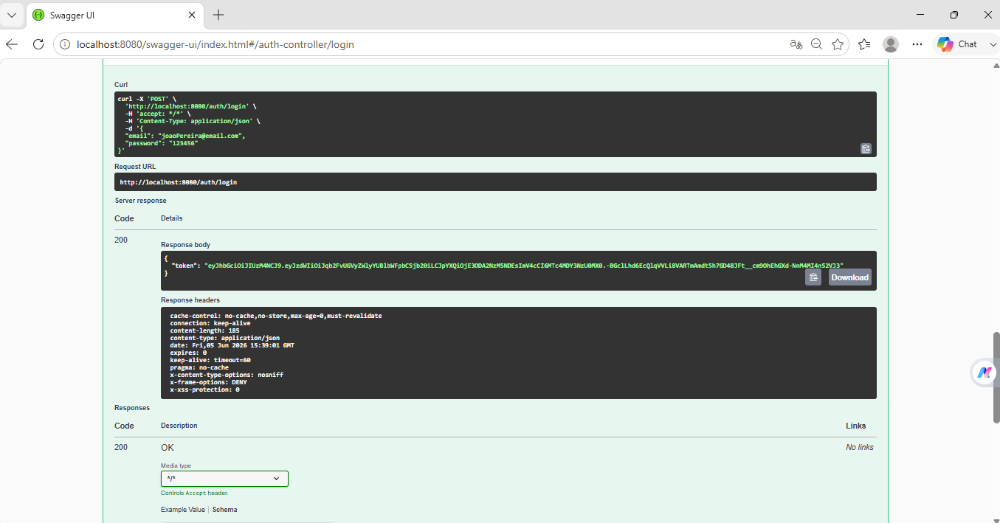
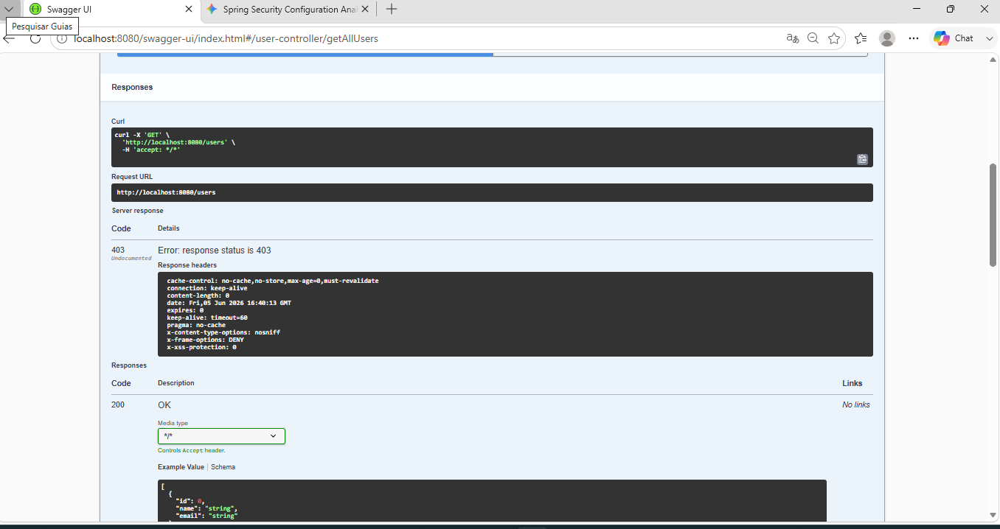
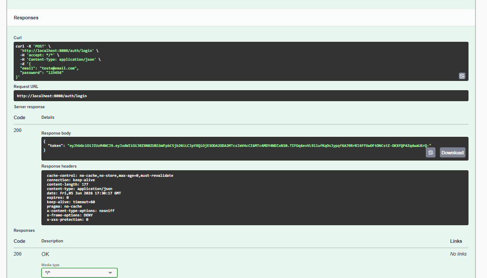
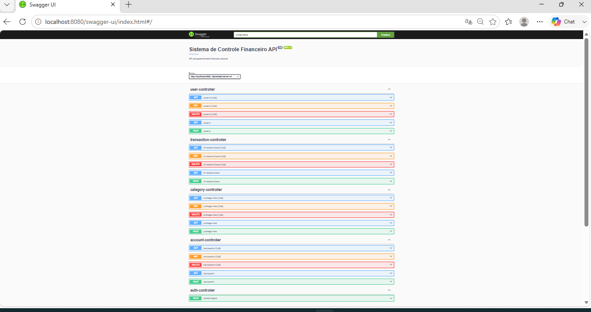
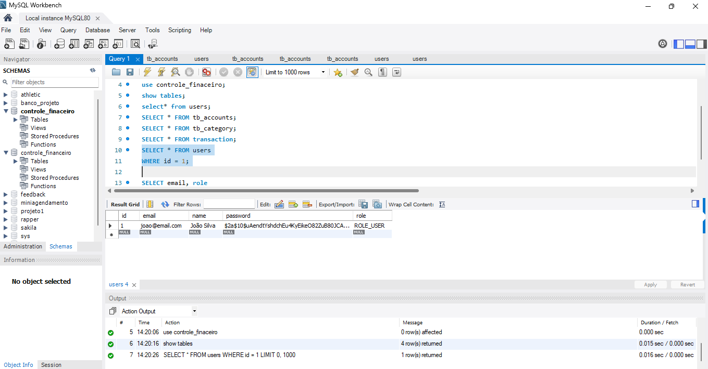

# Sistema de Controle Financeiro

API REST para controle financeiro pessoal, feita com **Java 21** e **Spring Boot**. Permite cadastrar usuários, contas, categorias e transações, com autenticação **JWT** e documentação interativa em **Swagger**.

## Tecnologias

Java 21 · Spring Boot · Spring Data JPA · Spring Security · JWT · MySQL 8 · Maven · Swagger/OpenAPI · Docker e Docker Compose

## Funcionalidades

- **Usuários:** cadastro, consulta, atualização, exclusão e consulta do próprio perfil (`/users/me`).
- **Contas:** CRUD de contas financeiras.
- **Categorias:** CRUD de categorias para organizar as transações.
- **Transações:** CRUD de receitas e despesas.
- **Segurança:** login com JWT, senhas criptografadas com BCrypt, endpoints públicos e protegidos, usuário administrador criado na inicialização.
- **Qualidade de API:** DTOs de entrada e saída, validação de dados e tratamento global de exceções.

## Arquitetura

Arquitetura em camadas, com separação de responsabilidades:

```text
Controller  →  Service  →  Repository  →  MySQL
```

```text
src/main/java
├── config        (OpenAPI, inicialização do administrador)
├── controller
├── dto
├── entity
├── exceptions    (tratamento global de erros)
├── repository
├── security      (JWT e Spring Security)
└── service
```

## Como rodar

Pré-requisito: Docker.

```bash
# defina a senha do usuário administrador (admin@sistema.com)
export ADMIN_PASSWORD=sua_senha_aqui      # Windows (PowerShell): $env:ADMIN_PASSWORD="sua_senha_aqui"

docker compose up --build
```

A API sobe em `http://localhost:8080` e o MySQL na porta `3307`.
Documentação interativa: `http://localhost:8080/swagger-ui/index.html`

> A senha do MySQL no `docker-compose.yml` serve apenas para desenvolvimento local.

## Endpoints

| Recurso | Rotas | Acesso |
|---|---|---|
| Cadastro | `POST /users` | público |
| Login | `POST /auth/login` | público |
| Usuários | `GET /users`, `GET /users/{id}`, `GET /users/me`, `PUT /users/{id}`, `DELETE /users/{id}` | token |
| Contas | `POST/GET /accounts`, `GET/PUT/DELETE /accounts/{id}` | token |
| Categorias | `POST/GET /categories`, `GET/PUT/DELETE /categories/{id}` | token |
| Transações | `POST/GET /transactions`, `GET/PUT/DELETE /transactions/{id}` | token |

### Exemplo: cadastro e login

```json
// POST /users
{ "name": "João Silva", "email": "joao@email.com", "password": "123456" }

// POST /auth/login  ->  { "token": "SEU_TOKEN_JWT" }
{ "email": "joao@email.com", "password": "123456" }
```

Nos endpoints protegidos, envie o token no cabeçalho:

```http
Authorization: Bearer SEU_TOKEN_JWT
```

## Capturas de tela

| Cadastro | Login e token |
|---|---|
|  |  |

| Sem token (acesso negado) | Com token (acesso permitido) |
|---|---|
|  |  |

| Swagger | Banco MySQL |
|---|---|
|  |  |

## Próximos passos

- Frontend web
- Dashboard financeiro (totais por categoria e por período)
- Deploy em nuvem

## Autor

**Junior Rodrigues** — estudante de Análise e Desenvolvimento de Sistemas (Uninter), com foco em Java e Spring Boot.
[GitHub](https://github.com/juniorcarlito20) · [LinkedIn](https://linkedin.com/in/junior-rodrigues-b63b4640b)
